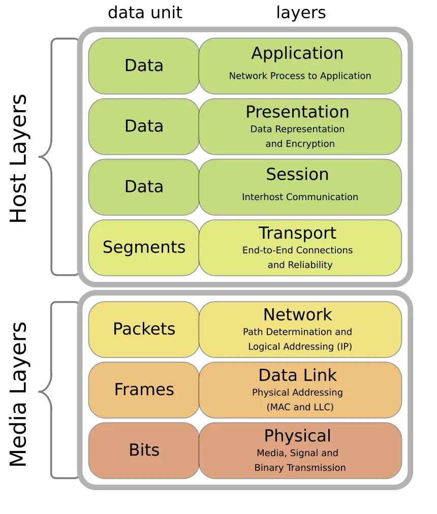

*This project has been created as part of the 42 curriculum by amantoux.*

# NetPractice

## Description
 NetPractice is our first project of network designed to introduce us to the basics of computer networking configure IP addresses, connect devices through a router and understand the role of a gateway within a network.

## Instruction

- First you need to download `net_practice.1.9.tgz`

- Go to the place you downloaded it and write/enter the command line `tar -xvf net_practice.1.9.tgz`

- Enter in the directory net_practice and run `sh run.sh`

- Now you have access to the net_practice website. You can choose practice or exam mode. When you resolved any of the levels you can export your configaration level (a json file will be download). Exam mode is a 3 level test (level given are between 6 and 10).

## OSI model

   

## TCP/IP addressing

   

## Subnet masks

## Default gateway

## Network devices

Routers and switches are both network devices but they are not aiming the same goal.

### Routers

A router operates on layer 3 of the OSI model and use IP addressing. It goal is to link differents network together expecially by linking your local network (LAN) to the internet. It handles security (firewall), the NAT* (Network Address Translation), the DHCP (Dynamic Host Configaration Protocol) and permit wifi access.

*NAT is a network mechanism that allows to modify IP addresses on the headers of data packages that transits by a router or a firewall. It mainly serves to convert private IP addresses to public IP addresses.

*DHCP is a network protocol that attribute IP addresses to the connected devices and other network configurations like subnet masks, DNS (Domain name system) Server, etc... 

### Switches

The switch operates at layer 2 of the OSI model and uses MAC addresses. It connects multiple devices within the same local network (such as PCs, printers, or servers). It directs data only to the intended device, which optimizes performance and reduces collisions compared to older hubs.

The MAC (Media Access Control) address is a unique 48-bit physical identifier, coded in hexadecimal, etched into the chip of each network card (NIC) to identify a device on a local network.

### Internet Protocol

IP addresse is a 32-bit identifier...

- **IpV4**:

- **IpV6**:

## Resources
