<h1 align=center>
	<b>Net_Practice</b>
</h1>

<h2 align=center>
	<i>Projet n°10 du cursus 42</i>
</h2>

	Le projet <b>net_practice</b> est notre premier projet lié aux réseaux dans le cursus 42. Il consiste en 10 exercices dans lesquels nous devons configurer différents réseaux à petite échelle pour qu'ils communiquent entre eux - le tout en utilisant les concepts appris sur l'adressage TCP/IP.

<h2 align=center> Sommaire </h2>
<h3 align="center"><b>
	<a href="#Network">Qu'est-ce qu'un réseau ?</a>
	 • 
	<a href="#TCP">Que sont TCP et l'adresse IP ?</a>
	 • 
	<a href="#IPv4">IPv4 et masques de sous-réseau</a>
	 • 
	<a href="#Connecting">Connecter plusieurs appareils</a>
	 • 
	<a href="#Switch">Switch (Commutateur)</a>
	 • 
	<a href="#Router">Routeur</a>
	 • 
	<a href="#RouterTable">Table de routage</a>
	 • 
	<a href="#NetPractice">Net Practice</a>
</b></h3>

---

# Avant toute chose...

<h2 id="Network">
Qu'est-ce qu'un réseau ?
</h2>

Pour faire simple, un **Réseau** informatique est un groupe de deux appareils ou plus qui peuvent communiquer entre eux. Par communiquer, nous entendons la possibilité d'**envoyer** et de **recevoir** des données (ou *paquets*) - entre différents appareils (ou *nœuds*).

**Internet** est l'un des nombreux exemples de réseau. C'est probablement le plus grand réseau au monde, et il connecte de nombreux nœuds différents, rendant le partage de données possible entre des appareils situés n'importe où dans le monde.

Internet est considéré comme un **Réseau Public**. Un réseau public permet le transfert de données entre n'importe quel appareil qui y est connecté, avec peu ou pas de contrôle d'accès. En général, il est exploité par une entreprise de télécommunications dans le but spécifique de fournir des services de transmission de données au public.

D'un autre côté, nous avons également les **Réseaux Privés**. Un réseau privé permet la communication entre des appareils restreints à un emplacement ou un domaine spécifique. Le transfert de données n'est pas autorisé pour les personnes non enregistrées, ce qui en fait un environnement beaucoup plus sûr et contrôlé. Un réseau domestique est un exemple de réseau privé. Chez vous, vous pouvez vous connecter à votre imprimante personnelle alors que personne d'autre n'étant pas connecté au Wi-Fi de votre maison ne pourrait le faire.

<h2 id="TCP">
Que sont TCP et l'adresse IP ?
</h2>

Afin de transférer des données d'un point à un autre à travers un réseau, de nombreux types de protocoles différents existent pour garantir l'accès, le transport, la sécurité et la stabilité. Tous ces protocoles fonctionnent ensemble, chacun étant responsable de ce qu'on appelle une « couche » dans le processus de communication.

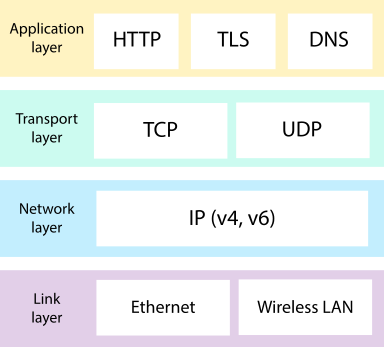

Le **Transmission Control Protocol** (ou **TCP**) est un protocole standard de communication qui permet aux nœuds de communiquer entre eux. Le TCP est responsable du « découpage » des données en petits morceaux (ou paquets), de leur envoi sur le réseau, puis de leur « reconstruction » à l'arrivée tout en veillant à ce qu'aucune donnée ne soit perdue au cours du processus.

Et comment sait-il où envoyer ces morceaux ? Il le fait en utilisant une **adresse IP** (*Internet Protocol Address*), qui est une série de chiffres utilisée pour identifier tout appareil connecté à un réseau, qu'il soit public ou privé.

TCP et IP ne sont pas la même chose, mais plutôt **deux protocoles distincts** qui travaillent ensemble afin d'assurer le transfert de données entre différents appareils.

Il existe deux versions différentes d'adresses IP : **IPv4** et **IPv6**. Dans le cadre de ce projet, nous n'aurons besoin de connaître que l'IPv4, le modèle de protocole le plus ancien et le plus largement utilisé. À partir de maintenant, dans ce guide, nous utiliserons les termes IP et IPv4 de manière interchangeable.

<h2 id="IPv4">
IPv4 et masques de sous-réseau
</h2>

Une adresse IPv4 est un nombre de 32 bits divisé en quatre blocs de 8 bits.

Chacun de ces blocs va de `0` à `255` ou, en binaire, de `00000000` à `11111111`.

Il est fondamental d'apprendre à visualiser chaque adresse IP sous sa forme binaire. La raison en est que chaque adresse IP peut être divisée en deux informations distinctes : l'adresse de **Réseau** (*Network*) et l'adresse d'**Hôte** (*Host*).

La partie correspondant à l'**adresse de réseau** est l'identifiant du réseau auquel les appareils sont connectés. Pour pouvoir communiquer entre eux, les nœuds doivent tous être sur le même réseau et donc avoir la même partie d'adresse réseau dans leurs IP respectives.

La partie correspondant à l'**adresse d'hôte** est l'identifiant individuel de l'appareil. Chaque nœud d'un même réseau doit avoir une adresse d'hôte unique.

Pour identifier quelle partie de l'adresse IP complète correspond au réseau et laquelle correspond à l'hôte, nous devons lui appliquer un **masque de réseau** (ou **masque de sous-réseau**).

Un masque est également un nombre de 32 bits divisé en quatre blocs de 8 bits. Cependant, son rôle est d'identifier quels bits font activement partie de l'identification du réseau. Pour ce faire, il marque avec des 1 les bits de réseau.

Il existe deux façons de représenter un masque : par un masque IP complet ou par le CIDR.

Regardons un exemple :

	Adresse IP :		153.172.250.12
	Masque de sous-réseau :	255.255.255.0
	CIDR :			/24

En binaire, respectivement, nous avons :

	Adresse IP :		10011001.10101100.11111010.00001100
	Masque de sous-réseau :	11111111.11111111.11111111.00000000

Selon le masque, les 24 premiers bits sont marqués comme faisant partie de l'adresse de réseau. Cela signifie que les 24 premiers bits de l'adresse IP représentent l'adresse du réseau.

	Adresse de réseau :	10011001.10101100.11111010.????????
	ou :			153.172.250.?
	IP/CIDR :		153.172.250.12/24

En termes pratiques, nous pouvons dire que tout appareil dont l'IP est comprise entre `192.172.250.0` et `192.172.250.255` se trouve sur le même réseau et peut donc communiquer librement avec les autres.

Regardons un autre exemple :

	Adresse IP :		153.172.175.12
	Masque de sous-réseau :	255.255.240.0
	CIDR :			/20

En binaire, respectivement, nous avons :

	Adresse IP :		10011001.10101100.10101111.00001100
	Masque de sous-réseau :	11111111.11111111.11110000.00000000

Selon le masque, désormais les 20 premiers bits sont marqués comme faisant partie de l'adresse de réseau. Cela signifie que les 20 premiers bits de l'adresse IP représentent l'adresse réseau.

	Adresse de réseau :	10011001.10101100.1010????.????????
	ou :			153.172.(160-175).(0-255)
	IP/CIDR :		153.172.175.12/20

En termes pratiques, nous pouvons dire que tout appareil dont l'IP est comprise entre `192.172.160.0` et `192.172.175.255` se trouve sur le même réseau et peut donc communiquer librement avec les autres.

Il est important de noter que dans le masque de réseau, en le lisant de gauche à droite, dès qu'un `zéro` apparaît, le masque se poursuivra uniquement avec des zéros. Cela signifie que `255.255.240.0` est un masque valide, mais que `255.255.240.128` ne l'est pas.
Pour les masques, il n'y a que neuf blocs de 8 bits possibles :

	0 0 0 0 0 0 0 0 ->	0 
	1 0 0 0 0 0 0 0 ->	128
	1 1 0 0 0 0 0 0 ->	192
	1 1 1 0 0 0 0 0 ->	224
	1 1 1 1 0 0 0 0 ->	240
	1 1 1 1 1 0 0 0 ->	248
	1 1 1 1 1 1 0 0 ->	252
	1 1 1 1 1 1 1 0 ->	254
	1 1 1 1 1 1 1 1 ->	255

Cependant, il est également important de comprendre que, dans ce processus de division d'un grand réseau en réseaux plus petits ou sous-réseaux, nous devons réserver 2 adresses IP qui ne peuvent être utilisées par aucun appareil.

La **première IP de la plage** est réservée pour identifier le sous-réseau.

La **dernière IP de la plage** est réservée à la diffusion de messages (*broadcast*) à tous les appareils du sous-réseau.

Dans le premier exemple, les IP `192.172.250.0` et `192.172.250.255` seraient réservées. Seules les IP allant de `192.172.250.1` à `192.172.250.254` pourraient être attribuées à d'autres appareils.

Cela signifie, en termes pratiques, que nous devons choisir les masques de réseau avec soin, en ayant à l'esprit le nombre d'appareils que l'on prévoit de connecter à son réseau.

| CIDR | MASQUE DE SOUS-RÉSEAU | MASQUE GÉNÉRIQUE (WILDCARD) | NBR D'ADRESSES IP | NBR D'IP UTILISABLES |
|------|-------------|---------------|-------------------|-------------------|
| /32 |	255.255.255.255 |	0.0.0.0 |	1	| 1
| /31 |	255.255.255.254 |	0.0.0.1 |	2	| 2
| /30 |	255.255.255.252 |	0.0.0.3 |	4	| 2
| /29 |	255.255.255.248 |	0.0.0.7 |	8	| 6
| /28 |	255.255.255.240 |	0.0.0.15 |	16	| 14
| /27 |	255.255.255.224 |	0.0.0.31 |	32	| 30
| /26 |	255.255.255.192 |	0.0.0.63 |	64 	| 62
| /25 |	255.255.255.128 |	0.0.0.127 |	128 | 126
| /24 |	255.255.255.0 |	0.0.0.255 |	256	| 254
| /23 |	255.255.254.0 |	0.0.1.255 |	512	| 510
| /22 |	255.255.252.0 |	0.0.3.255 |	1 024 |	1 022
| /21 |	255.255.248.0 |	0.0.7.255 |	2 048 |	2 046
| /20 |	255.255.240.0 |	0.0.15.255 |	4 096	| 4 094
| /19 |	255.255.224.0 |	0.0.31.255 |	8 192	| 8 190
| /18 |	255.255.192.0 |	0.0.63.255 |	16 384	| 16 382
| /17 |	255.255.128.0 |	0.0.127.255 |	32 768	| 32 766
| /16 |	255.255.0.0 |	0.0.255.255 |	65 536	| 65 534
| /15 |	255.254.0.0 |	0.1.255.255 |	131 072	| 131 070
| /14 |	255.252.0.0 |	0.3.255.255 |	262 144	| 262 142
| /13 |	255.248.0.0 |	0.7.255.255 |	524 288	| 524 286
| /12 |	255.240.0.0 |	0.15.255.255 |	1 048 576 |	1 048 574
| /11 |	255.224.0.0 |	0.31.255.255 |	2 097 152 |	2 097 150
| /10 |	255.192.0.0 |	0.63.255.255 |	4 194 304 |	4 194 302
| /9 |	255.128.0.0 |	0.127.255.255 |	8 388 608 |	8 388 606
| /8 |	255.0.0.0 |	0.255.255.255 |	16 777 216	|16 777 214
| /7 |	254.0.0.0 |	1.255.255.255 |	33 554 432	|33 554 430
| /6 |	252.0.0.0 |	3.255.255.255 |	67 108 864	|67 108 862
| /5 |	248.0.0.0 |	7.255.255.255 |	134 217 728	|134 217 726
| /4 |	240.0.0.0 |	15.255.255.255 |	268 435 456 |	268 435 454
| /3 |	224.0.0.0 |	31.255.255.255 |	536 870 912 |	536 870 910
| /2 |	192.0.0.0 |	63.255.255.255 |	1 073 741 824 |	1 073 741 822
| /1 |	128.0.0.0 |	127.255.255.255 |	2 147 483 648 |	2 147 483 646
| /0 |	0.0.0.0 |	255.255.255.255 |	4 294 967 296 |	4 294 967 294

<h2 id="Connecting">
Connecter plusieurs appareils
</h2>

Comme mentionné précédemment, les réseaux publics comme **Internet** sont établis par un fournisseur de télécommunications afin de connecter des appareils du monde entier.

Une **Adresse IP Publique** est attribuée par votre **Fournisseur d'Accès à Internet** (ou **FAI**), directement dans votre **routeur** personnel, et permet une connectivité directe vers votre réseau privé personnel.

Votre réseau privé est établi par un **switch** situé à l'intérieur du routeur fourni par votre FAI. Votre routeur est responsable de l'attribution d'une **Adresse IP Privée** directement à tout appareil connecté à votre réseau privé, en suivant les règles mentionnées précédemment concernant les masques de sous-réseau et les IP.

Certaines adresses IP sont réservées à des usages spécifiques. Par conséquent, lors de l'attribution d'une adresse IP au sein d'un réseau connecté à Internet, vous devez prêter attention à la liste ci-dessous :

Plage d'adresses IP | Réservée |
----------------------|-----------|
10.0.0.0 - 10.255.255.255 | réservée aux IP privées (Classe A)
127.0.0.0 - 127.255.255.255 | réservée pour le loopback et les tests internes
172.16.0.0 - 172.31.255.255 | réservée aux IP privées (Classe B)
192.168.0.0 - 192.168.255.255 | réservée aux IP privées (Classe C)
224.0.0.0 – 239.255.255.255 | réservée au multicast
240.0.0.0 – 255.255.255.255 | réservée au domaine expérimental, utilisée pour la recherche

<h3 id="Switch">
Switch (Commutateur)
</h3>

Un **switch** réseau est responsable de la distribution des paquets entre les appareils d'un même réseau - généralement un réseau local (appelé LAN). Un switch n'a pas d'interface propre et ne peut pas communiquer avec un réseau extérieur au sien.

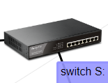

<h3 id="Router">
Routeur
</h3>

Un **routeur** est responsable de la connexion de plusieurs réseaux entre eux. Chaque routeur dispose d'une interface pour chaque réseau auquel il est connecté.

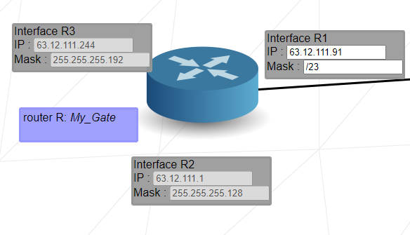

Puisqu'il connecte plusieurs réseaux ensemble, la plage des adresses IP possibles sur l'une de ses interfaces ne doit jamais chevaucher la plage de ses autres interfaces. Un chevauchement de plages impliquerait que les interfaces appartiennent au même réseau.

<h3 id="RouterTable">
Table de routage
</h3>

Une **Table de routage** est une simple table de données stockée dans un routeur ou un hôte réseau qui répertorie toutes les routes vers une destination réseau particulière.

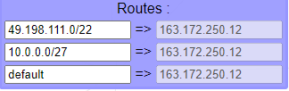

Dans Net Practice, une table de routage se compose de deux informations simples :

- **Destination** (à gauche) : c'est l'adresse IP à laquelle vous souhaitez envoyer un paquet, combinée avec le CIDR de ce réseau : `190.3.2.252/30`. Si vous ne souhaitez pas spécifier de destination, ou si vous voulez la rendre disponible pour l'ensemble du réseau, vous pouvez simplement la régler sur `default` ou `0.0.0.0/0`.

- **Next Hop** / Prochain saut (à droite) : c'est l'adresse IP du prochain routeur auquel vous devez envoyer les paquets afin d'atteindre le réseau de destination.

<h1 id="NetPractice">
Net Practice
</h1>

  
Niveau 1

   
  
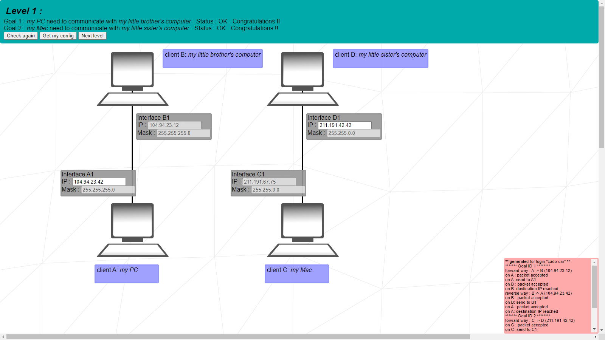

Le premier exercice de la liste est un problème simple de communication directe entre deux appareils. Vous devez vous assurer que chaque paire d'appareils devant communiquer se trouve bien sur le même réseau.

Pour Client A et Client B, qui ont tous deux un masque de sous-réseau `255.255.255.0` ou un CIDR `/24`, vous devez vous assurer que l'adresse IP de A correspond au même réseau que B, qui est `104.94.23.0/24`. Cela signifie que l'adresse IP du Client A peut être comprise dans la plage allant de `104.94.23.1` à `104.94.23.254` (en se rappelant que les extrémités de la plage sont réservées respectivement au réseau et au broadcast).

Pour Client C et Client D, la même règle s'applique, mais ils ont maintenant un masque de sous-réseau `255.255.0.0` ou un CIDR `/16`. Par conséquent, vous devez vous assurer que l'adresse IP de D correspond au même réseau que C, à savoir `211.191.0.0/16`. Cela signifie que l'adresse IP du Client D peut appartenir à la plage allant de `211.191.0.1` à `211.191.255.254`.

---

  
Niveau 2

   

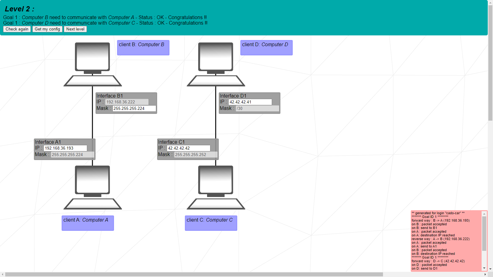

Pour ce niveau, il est important de garder quelques éléments à l'esprit.

Premièrement, la nécessité pour tous les appareils d'un même réseau d'avoir le même masque.

Deuxièmement, vous ne pouvez pas utiliser d'IP réservées pour des adresses privées qui ne sont pas spécifiques à cet usage.

Pour la connexion entre Client A et Client B, tous deux doivent avoir le même masque `255.255.255.224`, ou CIDR `/27`. Puisque l'adresse IP du Client B est déjà fixée à `192.168.36.222`, vous pouvez en déduire que la plage du réseau se situe entre `192.168.36.192` et `192.168.36.223`, extrémités exclues. Le Client A peut se situer n'importe où dans cette plage.

Pour Client C et Client D, cependant, nous avons un masque de `255.255.255.252`, ou CIDR `/30`. Pour ce masque, nous n'avons que 4 IP dans la plage, et seulement 2 disponibles à l'utilisation. Lorsque vous choisissez les IP pour ces derniers, vous devez vous assurer qu'elles ne sont pas réservées, et que les 2 derniers bits ne sont pas tous à 0 (premier de la plage) ni tous à 1 (réservé au broadcast).

---

  
Niveau 3

   

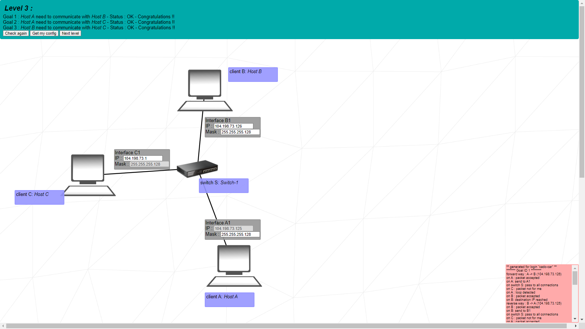

C'est le premier contact que nous avons avec les switches. Son utilisation est très similaire aux exercices précédents, la seule différence étant désormais la possibilité de communiquer entre 3 appareils distincts.

Les 3 clients doivent être sur le même réseau. Le masque du Client C est défini sur `255.255.255.128`, ou CIDR `/25`. Par conséquent, ce sera le masque pour tous les autres hôtes. L'adresse IP du Client A étant fixée à `104.198.73.125`, nous pouvons également en déduire que la plage pour ce réseau particulier ne peut aller que de `104.198.73.0` à `104.198.73.127`, extrémités exclues.

---

  
Niveau 4

   

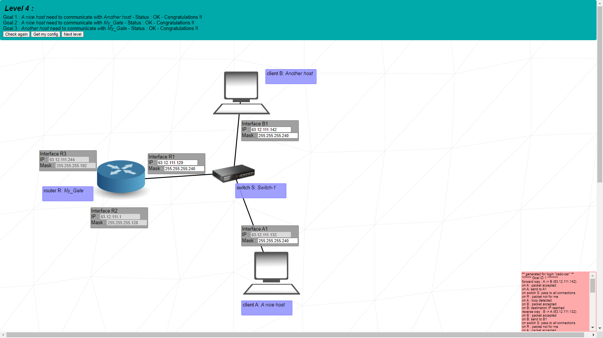

Cet exercice introduit le concept de routeur. Ce routeur en particulier possède 3 interfaces distinctes, chacune avec une adresse IP et un masque de sous-réseau.

Lors du choix de l'adresse IP et du masque pour l'**Interface R1** du routeur R, vous devez vous assurer qu'il n'y a pas de chevauchement des plages IP entre les interfaces.

L'**Interface R2**, par exemple, a une plage d'IP de `63.12.111.0` à `63.12.111.127`, tandis que l'**Interface R3** a une plage allant de `63.12.111.192` à `63.12.111.255`. Par conséquent, vous devez vous assurer que le masque choisi pour ce réseau particulier ne lui fera partager aucune de ces IP.

Pour ce faire, jetez un œil à l'adresse IP du Client A, fixée à `63.12.111.132`. Cette IP est située exactement entre les plages mentionnées précédemment. Il n'y a que 63 adresses possibles dans cette zone (`63.12.111.128` - `63.12.111.191`), vous pouvez donc utiliser un masque de CIDR `/27` ou supérieur. J'ai choisi un masque de `255.255.255.240`, ou CIDR `/28`, pour plus de sécurité.

En appliquant ce masque sur l'adresse IP du Client A, nous obtenons la plage allant de `63.12.111.128` à `63.12.111.143`, extrémités exclues, tout en s'assurant qu'il n'y ait aucun chevauchement dans le routeur R.

---

  
Niveau 5

   

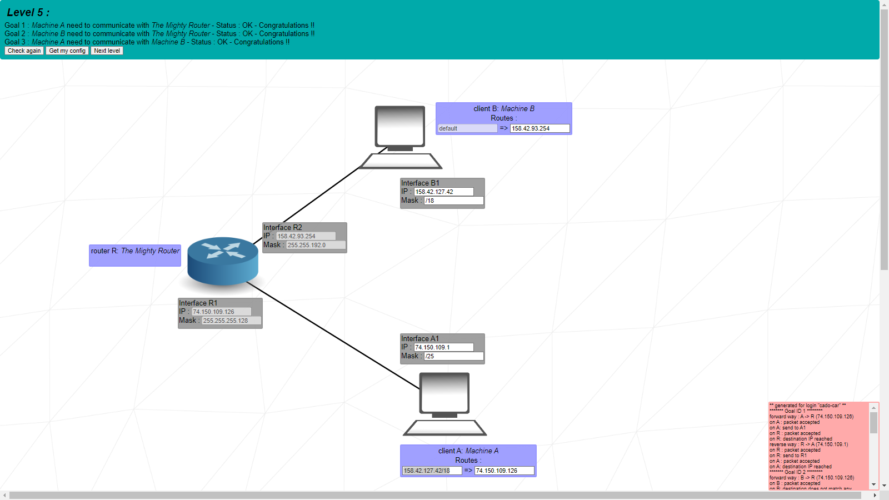

Dans cet exercice, une table de routage est introduite pour la première fois. L'idée ici est que chaque hôte doit disposer d'une table de routage permettant de se connecter au routeur et aux autres hôtes.

Commençons d'abord par établir les adresses IP et le masque pour chaque hôte.

Le Client A doit être situé sur le même réseau que l'Interface R1. Pour ce faire, il doit partager le même masque `255.255.255.128` ou CIDR `/25` et se trouver dans la plage d'adresses comprise entre `74.150.109.0` et `74.150.109.127`, extrémités exclues.

Le Client B doit être situé sur le même réseau que l'Interface R2. Pour ce faire, il doit partager le même masque `255.255.192.0` ou CIDR `/18` et se trouver dans la plage d'adresses comprise entre `158.42.64.0` et `158.42.127.255`, extrémités exclues.

Maintenant, configurons les tables de routage. Pour le Client A, vous devez le configurer de manière à permettre la communication avec le Client B. Pour ce faire, deux options s'offrent à vous : soit vous indiquez l'IP de destination comme étant l'adresse du Client B (`158.42.127.42/18`), soit vous la laissez sur **default** (`0.0.0.0/0`).

Le prochain saut (*next hop*) pour les deux tables sera l'adresse IP de l'interface du routeur R respective - le point de connexion le plus proche permettra d'établir la communication.

---

  
Niveau 6

   

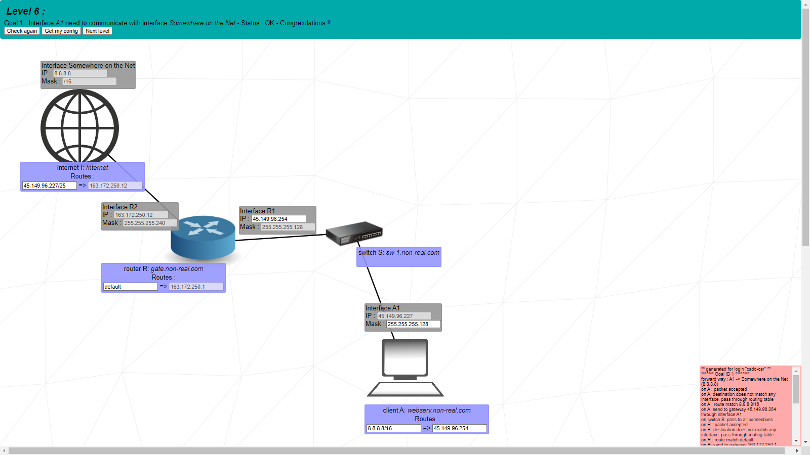

Ce niveau introduit la notion d'Internet.

Internet est simplement une sorte de routeur doté de nombreuses interfaces auxquelles il peut se connecter. Le but de cet exercice est de connecter le Client A jusqu'à Internet.

Tout d'abord, définissons toutes les adresses IP et tous les masques. Pour le Client A et l'Interface R1 du routeur R, qui se trouvent dans le même réseau local via un switch, nous devons leur attribuer le même masque `255.255.255.128` ou CIDR `/25`.

L'Interface R1 doit avoir une IP dans la plage de `45.149.96.128` et `45.149.96.255`, extrémités exclues.

Maintenant, concernant les tables de routage, nous devons garder en tête de connecter le Client A à Internet et vice-versa.

La destination de la route du Client A doit être l'**Interface Quelque part sur le Net** (*Somewhere on the Net*), c'est-à-dire `8.8.8.8/16` ou **default**. Le prochain saut (*next hop*) pour cette table est l'IP de l'Interface R1 du routeur R, `45.149.96.254`, ce qui constitue l'étape logique suivante pour se connecter à Internet.

La destination de la route d'Internet I doit être l'IP de l'Interface A1, qui est `45.149.96.227/25`, ou simplement **default**, puisque le prochain saut (*next hop*) pour cette route est l'Interface R2 du routeur R.

Cependant, la table de routage du routeur R possède un prochain saut qui ne correspond à aucune IP d'interface du schéma, vous pouvez donc régler sa destination sur **default**, car cela n'impactera pas les autres connexions.

---

  
Niveau 7

   

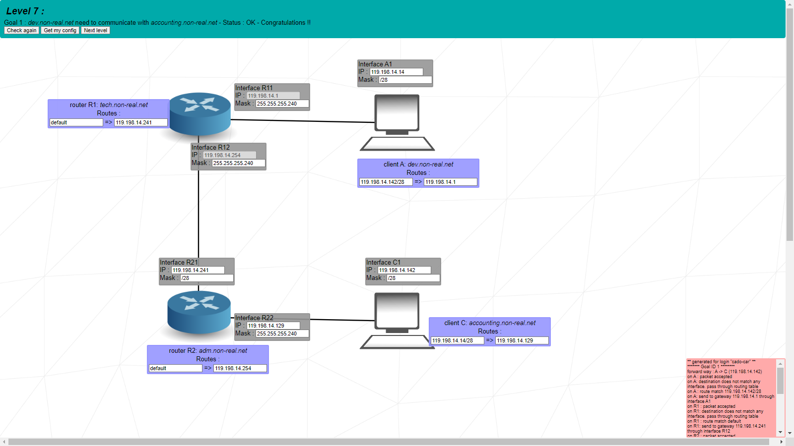

Dans ce niveau, la notion de chevauchement est fondamentale pour sa résolution.

En analysant le schéma, vous pouvez remarquer l'existence de trois réseaux distincts :

- **Réseau 1** : Entre l'Interface A1 et l'Interface R11
- **Réseau 2** : Entre l'Interface R12 et l'Interface R21
- **Réseau 3** : Entre l'Interface R22 et l'Interface C1

Chacun de ces réseaux doit avoir sa propre plage d'IP et peut avoir son propre masque de sous-réseau. Il ne peut y avoir aucun chevauchement d'IP entre les réseaux d'un même routeur.

Les deux seules IP de l'interface du Routeur R1 étant déjà fixées, vous devez choisir soigneusement les masques de ces réseaux. Le moyen le plus simple est de choisir un masque capable de diviser le réseau en sous-réseaux à faible plage. J'ai choisi un CIDR de `/28` pour tous les réseaux, ce qui me donne 16 adresses IP au total pour chacun, largement suffisant pour cette situation particulière.

Il est toutefois important de remarquer que vous n'avez pas besoin de choisir le même masque pour tous les réseaux. C'est selon votre convenance.

Avec un masque de `/28`, nous pouvons ensuite choisir les IP de chaque hôte comme suit :

- **Réseau 1** : De `119.198.14.0` à `119.198.14.15` (extrémités exclues, ainsi que l'IP propre de l'Interface R11 `119.198.14.1`)
- **Réseau 2** : De `119.198.14.240` à `119.198.14.255` (extrémités exclues, ainsi que l'IP propre de l'Interface R12 `119.198.14.254`)
- **Réseau 3** : Vous pouvez choisir les meilleures IP selon vos propres critères. J'ai choisi une plage allant de `119.198.14.128` à `119.198.14.143` (extrémités exclues).

Après avoir configuré les adresses IP appropriées, vous devez remplir les tables de routage en conséquence, sachant que la destination du Client A doit être l'IP de l'interface du Client C, et inversement. Les routeurs doivent avoir pour prochains sauts (*next hops*) leurs interfaces respectives afin de permettre la communication aller et retour.

---

  
Niveau 8

   

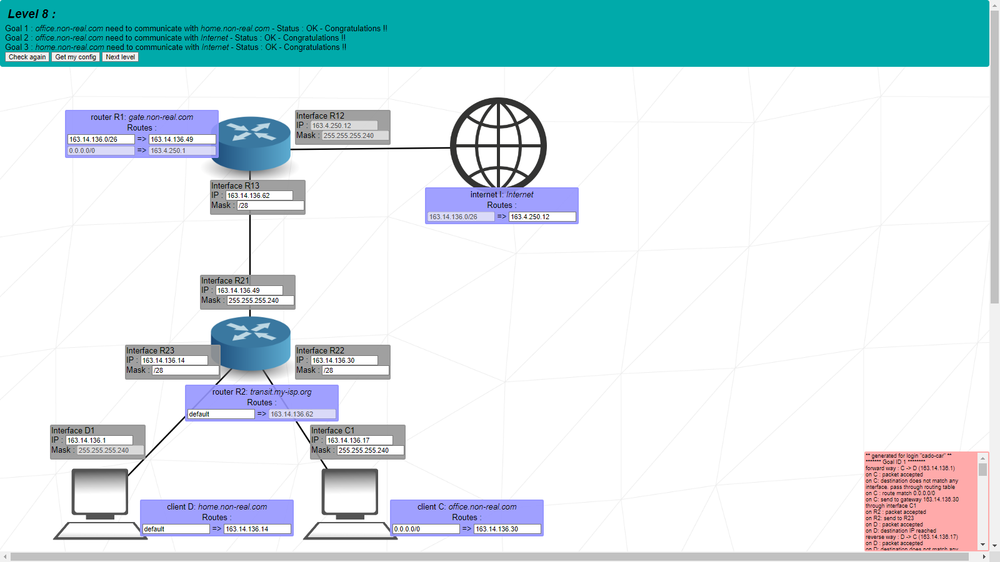

Dans ce niveau, vous devez établir une communication avec Internet depuis deux hôtes différents : Client C et Client D.

Internet possède une table de routage avec une route de destination vers `163.14.136.0/26`. Cela signifie qu'il peut renvoyer des paquets depuis des IP allant de `163.14.136.0` à `163.14.136.63`.

Cela implique que tous les réseaux sur le chemin menant à la destination finale des paquets doivent se trouver dans cette plage, sans que leurs IP ne se chevauchent.

Comme pour l'exercice précédent, nous avons également 3 réseaux à établir :

- **Réseau 1** : Entre l'Interface C1 et l'Interface R22
- **Réseau 2** : Entre l'Interface D1 et l'Interface R23
- **Réseau 3** : Entre l'Interface R21 et l'Interface R13

La solution la plus simple consiste à diviser la plage totale en 4 à l'aide d'un masque `/28`.

Sachant que le prochain saut (*next hop*) pour la table de routage du routeur R2 est `163.14.136.62`, ceci devrait être l'adresse IP de l'Interface R13.

Avec ces contraintes en tête, vous pouvez attribuer les IP comme suit : 

- **Réseau 1** : De `163.14.136.16` à `163.14.136.30` (extrémités exclues)
- **Réseau 2** : De `163.14.136.0` à `163.14.136.15` (extrémités exclues)
- **Réseau 3** : De `163.14.136.48` à `163.14.136.63` (extrémités exclues).

Ensuite, remplissez les tables de routage en tenant compte du fait que les prochains sauts (*next hops*) des routeurs R1 et R2 doivent pointer l'un vers l'autre, et que la destination des clients C et D doit être réglée sur `default`.

---

  
Niveau 9

   

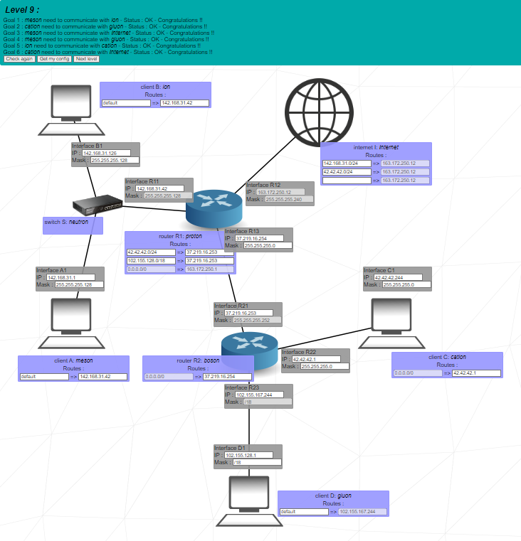

Ce niveau est une synthèse de tous les concepts vus précédemment dans cette liste d'exercices.

Pour commencer, comme d'habitude, vous devez accéder correctement à toutes les adresses IP. Gardez à l'esprit quelles adresses sont réservées et lesquelles appartiennent au même réseau.

Il y a 4 réseaux configurables dans ce niveau :

- **Réseau 1** : Entre l'Interface A1, l'Interface B1 et l'Interface R11
- **Réseau 2** : Entre l'Interface C1 et l'Interface R22
- **Réseau 3** : Entre l'Interface D1 et l'Interface R23
- **Réseau 4** : Entre l'Interface R13 et l'Interface R21

Pour chaque réseau, il y a un masque spécifique et une plage d'adresses IP. Pour ma résolution, j'ai choisi les paramètres suivants :

- **Réseau 1** : Masque `/25`, et adresses IP comprises entre `142.168.31.0` et `142.168.31.127`.
- **Réseau 2** : Masque `/24`, et adresses IP comprises entre `42.42.42.0` et `42.42.42.244`.
- **Réseau 3** : Masque `/18` (pré-configuré), et adresses IP comprises entre `102.155.128.0` et `102.155.128.255` (l'Interface R23 est déjà pré-configurée avec l'IP du prochain saut de la table de routage du client D : `102.155.167.244`).
- **Réseau 4** : Masque `/30` (pré-configuré), et adresses IP comprises entre `37.219.16.252` et `37.219.16.255`.

Après cela, nous devons définir les tables de routage pour permettre l'accès entre les réseaux. La plus importante est la table de routage d'Internet, qui doit contenir les adresses du *meson* et du *cation*, car ce sont les deux hôtes qui doivent communiquer directement avec lui.

---

  
Niveau 10

   

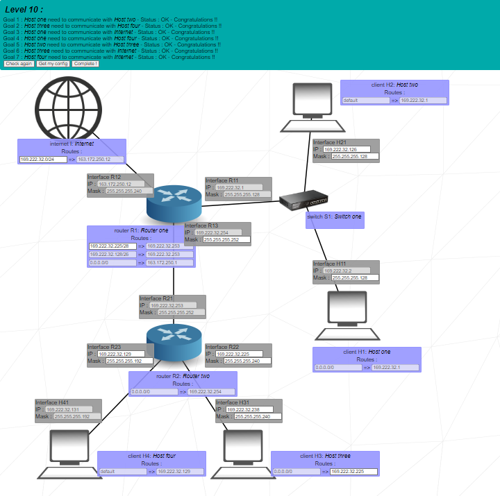

C'est l'un des exercices les plus simples de cette liste.

La majorité des paramètres sont déjà pré-configurés. Tout ce à quoi vous devez faire attention, c'est au chevauchement. Puisqu'Internet n'a qu'une seule route configurée vers le routeur R1, tous les réseaux doivent être dans la même plage, sans chevauchement de sous-réseaux.

Nous avons ici 4 réseaux :

- **Réseau 1** : Entre l'Interface H11, l'Interface H21 et l'Interface R11
- **Réseau 2** : Entre l'Interface H31 et l'Interface R22
- **Réseau 3** : Entre l'Interface H41 et l'Interface R23
- **Réseau 4** : Entre l'Interface R21 et l'Interface R13
  
Pour chaque réseau, il y a un masque spécifique et une plage d'adresses IP. Pour ma résolution, j'ai choisi les paramètres suivants :

- **Réseau 1** : Masque `/25`, et adresses IP comprises entre `169.222.32.0` et `169.222.32.127`.
- **Réseau 2** : Masque `/28`, et adresses IP comprises entre `169.222.32.224` et `169.222.32.239`.
- **Réseau 3** : Masque `/26`, et adresses IP comprises entre `169.222.32.129` et `169.222.32.129`.
- **Réseau 4** : Masque `/30`, et adresses IP comprises entre `169.222.32.252` et `169.222.32.255`.

Ensuite, vous devez configurer les tables de routage en conséquence, en gardant à l'esprit que la table de routage Internet consiste en une destination unique d'IP `169.222.32.0/24`.

